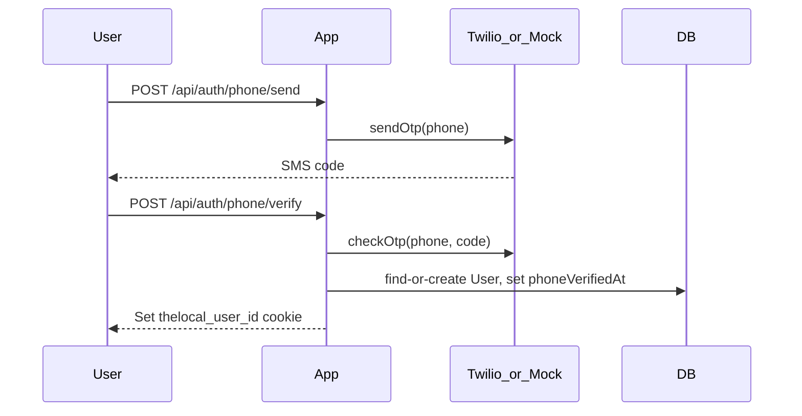

# Architecture

## Stack

| Layer | Technology |
|-------|------------|
| Framework | Next.js 16 (App Router) |
| UI | React 19, Tailwind CSS v4 |
| Language | TypeScript |
| Database | SQLite via Prisma 7 + better-sqlite3 adapter |
| Validation | Zod |
| Maps | Leaflet + react-leaflet (client-only) |
| Dates | date-fns |

## Project structure

```
communityhub/
├── prisma/           # Schema, migrations, seed
├── src/
│   ├── app/          # Pages and API routes (App Router)
│   ├── components/   # React components
│   ├── lib/          # Server utilities (db, auth, queries)
│   └── generated/    # Prisma client output
├── docs/             # Documentation
└── .grok/            # Agent config and references
```

## Request flow

```
Browser → Next.js page (Server Component)
       → src/lib/*.ts (data queries via Prisma)
       → SQLite (prisma/dev.db)

Browser → API route (POST/PATCH/DELETE)
       → Zod validation
       → getCurrentUser() auth check
       → Prisma mutation
       → JSON response
```

## Authentication (privacy-first)

Phone OTP is the primary identity layer:



**Providers** (`src/lib/sms.ts`):
- **Twilio Verify** when `TWILIO_*` env vars are set
- **Mock** otherwise — OTP logged to console, `devCode` returned in dev

**Session:** `thelocal_user_id` httpOnly cookie (30 days).

**Gates** (`src/lib/auth.ts`):
- `requireAuth()` — signed-in user
- `requirePhoneVerified()` — listings, messages; home-hosted RSVP

**Verified Host** (`verificationTier: VERIFIED_HOST`) is trust earned through event history and vouches — not tied to phone OTP.

## Data access patterns

- **Discovery:** `getListings()` in `src/lib/listings.ts` — filters by location (haversine), type, nature tag, paid status, interest, text search
- **Detail:** `getListingBySlug()` — includes interests, poster, RSVPs, announcements
- **Groups:** `getGroupBySlug()` — includes members and active listings
- **Host:** `isListingHost()` checks poster user or group admin membership
- **Alerts:** `getAlertMatches()` finds new listings matching user alert preferences

## Client vs server components

Server components are the default. Client components (`"use client"`) are used for:

- Interactive forms (post, settings, RSVP, login)
- Leaflet map (no SSR)
- Client-side fetch for messages and announcements

## Key design decisions

1. **SQLite for MVP** — zero-config local dev; adapter pattern ready for Postgres later
2. **Listing-scoped messages** — prevents platform from becoming a chat app
3. **Single nature tag** — keeps classification simple and visible upfront
4. **No feed algorithm** — chronological + distance sort only